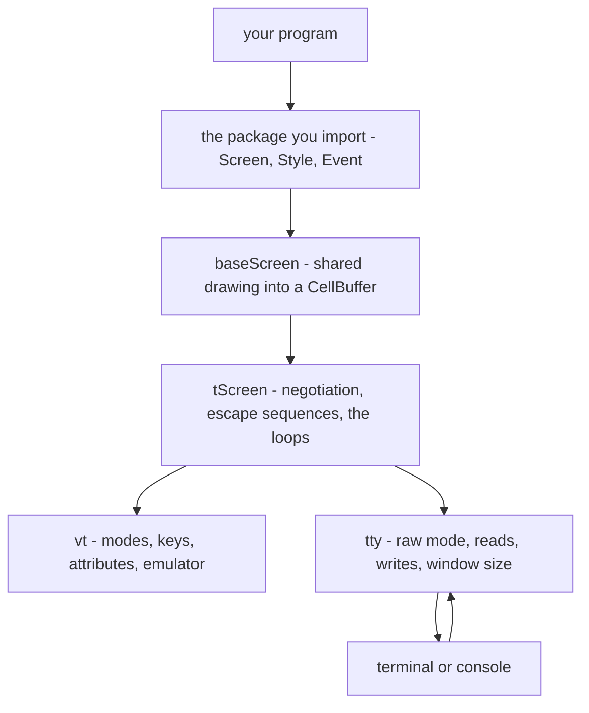
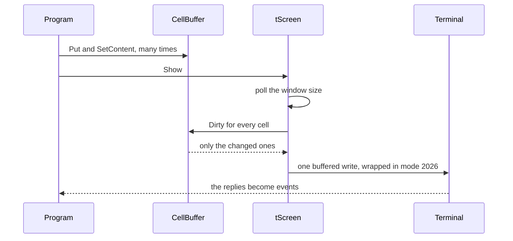
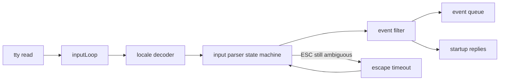

# Architecture

The understand path through _Tcell_: how a program's drawing calls become the fewest bytes a terminal can accept, and how the bytes a terminal sends back become events.

Sections cite the files they came from, since a file can be re-read and a version note cannot. Names stay in plain prose: [Function Reference](Function-Reference) owns them, [Terminal Setup](Terminal-Setup) what the shell sets.

## Two Layers

The layer an application imports is small: `screen.go` holds the Screen interface by itself, the rest mostly types. Under it, `tscreen.go` and `input.go` turn calls into bytes and bytes into events, with a tty package for raw reads and writes and a vt package for VT vocabulary.

Two facts make it a layering. One screen implementation: NewScreen builds the same screen NewTerminfoScreenFromTty builds, and a platform contributes only the Tty it hands over (`tscreen_unix.go` and its three siblings). One drawing surface: baseScreen in `screen.go` implements Put, Get, Fill and SetContent over a CellBuffer, so `tscreen.go` is only the part that talks to a terminal.

## The Screen Model

A program draws into a buffer and the terminal sees a diff: `cell.go` keeps what each cell holds now next to what was last drawn, and Dirty compares the pair before `tscreen.go` copies anything. One comparison per cell per frame, no display list.

Show takes the lock, polls the window size (the reason a resize is noticed even when the terminal never reports one), then writes only the changed cells in one flush. Sync additionally invalidates every cell and asks for a clear first, which the resize path also uses. A resize posts an EventResize, keeps what survives and invalidates the rest, so a program repaints on the event rather than patching what moved. LockRegion marks a rectangle un-drawable, for a picture written straight at the terminal.

## Backends

Here a backend is narrower than a port. The Backend interface in `vt/backend.go` is what a terminal _emulator_ plugs into - size, colors, one cell, cursor, private modes - and `vt/emulate.go` is the state machine that fills it in from a byte stream. `vt/mock.go` is the library using this on itself: a mock terminal that implements the Tty interface too, so a demo test can run the real screen against a grid nobody displays, as all eight do.

Portability sits lower, at the Tty interface in `tty/tty.go`: raw mode, reads, writes, window size, resize notice. Above that line the code is identical everywhere.

| System | Where the difference lives | What it arranges |
|---|---|---|
| POSIX | `tty/tty_unix.go` | /dev/tty, SIGWINCH |
| Windows | `tty/tty_win.go` | console records, VT output, UTF-16 |
| Plan 9 | `tty/tty_plan9.go` | /dev/cons, /dev/consctl, /dev/wctl |
| js/wasm | `wscreen.go` | a browser Tty, no device |

## Terminal Capability Handling

v3 deleted terminfo, and [the change note](https://github.com/gdamore/tcell/blob/main/CHANGESv3.md) says why. In its place: escapes treated as universal, a built-in table of them near the top of `tscreen.go`, and a startup conversation.

engageLocked in `tscreen.go` asks, in one burst, for the window size, in-band resize reports, mouse reporting, a keyboard protocol, the terminal's name, and last the primary device attributes, because that reply is the full stop. processInitQ waits one second and proceeds with whatever arrived, so a terminal that answers nothing gets a conservative guess, not a hung program. `$TERM` sorts terminals into families only, legacy and monochrome and st; unknown means xterm-like. Three terminals are known before they are asked, in applyKnownTerminalProfile.

## The Input Pipeline

Two goroutines per screen, in `tscreen.go`: inputLoop does the blocking read in one of its own so a stop can interrupt it, and mainLoop pushes the bytes through the locale decoder into the parser in `input.go`. Its header comment states the bet: one parser for every terminal, because key sequences are unambiguous. filterEvents keeps the terminal's own replies off the event queue, where keys, mouse, paste and resizes wait.

`input.go` also decides when to stop waiting. A lone Escape is ambiguous under every keyboard protocol, so it is held 50 ms before being called Escape, or 125 ms on Windows; once an introducer has arrived nothing is ambiguous, and the parser waits a full second. A program may lengthen the short number, and TCELL_ESCDELAY overrides it from the shell, a knob [Terminal Setup](Terminal-Setup) documents.

## Keyboard Protocols

Four, named in `key.go`: legacy VT100, kitty, win32-input-mode and xterm's modifyOtherKeys. Legacy is what a terminal that answers nothing gets, and why CTRL-I and TAB are one key. Kitty adds disambiguation, release events and physical keys, whose runes a layout in `vt/layout.go` supplies; win32-input-mode carries everything; modifyOtherKeys disambiguates without releases. Selection is a preference and not a transcript: keyboardProtocol in `tscreen.go` reports win32, else kitty, else xterm, else legacy.

Precedence matters, because the two overrides run at different moments: options apply when the screen is built, the environment in Init. So the environment outranks the option, the option outranks negotiation, and naming auto hands it back. Color counts run the other way, an option beating `$COLORTERM`. Advanced keys change meanings as well as event counts, listed in [the change note](https://github.com/gdamore/tcell/blob/main/CHANGESv3.md).

## The Output Pipeline

Once per frame, in `tscreen.go`: hide the cursor, buffer everything, and wrap the buffer in mode 2026, so a terminal that supports it paints the frame at once instead of over the reader's typing. Per dirty cell, move the cursor only when it is not already where it belongs, and emit styles only when they differ from the last emitted, sgr0 resetting before a rebuild. One flush ends it.

Color takes two roads: 24-bit once the screen has chosen truecolor, and palette indices up to 256 otherwise, an RGB color outside the palette being fitted by [color/fit.go](https://github.com/gdamore/tcell/blob/main/color/fit.go), which measures CIE76 distance cached per screen. Text takes four roads in encodeStr: UTF-8, the locale encoder, the alternate character set, registered fallbacks, then a question mark.

## Unicode and Width

A cell holds one grapheme cluster, which may be several runes, and is one or two cells wide; a wide cluster is marked dirty as a pair, and in the last column it becomes a space. Put hands back the rest of the string and the width it used, so a program can wrap text without measuring twice, and `cell.go` measures only when it must, skipping the segmenter for printable ASCII and for text it just measured.

Neither clustering nor width is in this library: both come from [_displaywidth_](https://github.com/clipperhouse/displaywidth) and [_uax29_](https://github.com/clipperhouse/uax29), configured once by `internal/widthutil` and shared by `cell.go` and the emulator. Character sets are separate: `charset_unix.go` reads the locale, `encoding.go` turns a name into an encoder and decoder.

## Concurrency

One mutex per screen, taken by every Screen method: baseScreen in `screen.go` locks around each write into the CellBuffer, and `cell.go` says the buffer is not thread safe, so safety belongs to the screen. A program keeps one rule that way, and keeps it by accident if it draws, shows and reads events together.

The library's goroutines are inputLoop, mainLoop and a short-lived one per resize. The event channel is the meeting point instead of a callback: reading is a select, and writing is allowed under two limits the source states, nothing after Fini in `screen.go`, and never from the goroutine that also reads - the deadlock [the tutorial](https://github.com/gdamore/tcell/blob/main/TUTORIAL.md#demo-application) warns about. Resume turns the modes back on without asking the terminal what it has, the answers from Init being kept.

## Where to Look in the Source

| File | What lives there |
|---|---|
| [screen.go](https://github.com/gdamore/tcell/blob/main/screen.go) | Screen interface, NewScreen, shared drawing |
| [tscreen.go](https://github.com/gdamore/tcell/blob/main/tscreen.go) | startup, negotiation, sequences sent |
| [tscreen_unix.go](https://github.com/gdamore/tcell/blob/main/tscreen_unix.go), [wscreen.go](https://github.com/gdamore/tcell/blob/main/wscreen.go) | which Tty a platform opens |
| [cell.go](https://github.com/gdamore/tcell/blob/main/cell.go) | cell buffer, dirty pair, region locks |
| [event.go](https://github.com/gdamore/tcell/blob/main/event.go), [key.go](https://github.com/gdamore/tcell/blob/main/key.go), [mouse.go](https://github.com/gdamore/tcell/blob/main/mouse.go), [style.go](https://github.com/gdamore/tcell/blob/main/style.go), [attr.go](https://github.com/gdamore/tcell/blob/main/attr.go) | types a program switches on |
| [input.go](https://github.com/gdamore/tcell/blob/main/input.go) | input state machine, escape timeouts |
| [tty/tty.go](https://github.com/gdamore/tcell/blob/main/tty/tty.go) and its implementations | Tty interface |
| [vt/emulate.go](https://github.com/gdamore/tcell/blob/main/vt/emulate.go), [vt/backend.go](https://github.com/gdamore/tcell/blob/main/vt/backend.go), [vt/mode.go](https://github.com/gdamore/tcell/blob/main/vt/mode.go), [vt/mock.go](https://github.com/gdamore/tcell/blob/main/vt/mock.go) | emulator, backends, modes, test terminal |
| [color/fit.go](https://github.com/gdamore/tcell/blob/main/color/fit.go) | fitting a color to a palette |
| [encoding.go](https://github.com/gdamore/tcell/blob/main/encoding.go), [charset_unix.go](https://github.com/gdamore/tcell/blob/main/charset_unix.go), [runes.go](https://github.com/gdamore/tcell/blob/main/runes.go), [eastasian.go](https://github.com/gdamore/tcell/blob/main/eastasian.go) | locale encoders, fallback glyphs, width |
| [gpm_linux.go](https://github.com/gdamore/tcell/blob/main/gpm_linux.go) | Linux console mouse over a socket |

## See Also

- [Getting Started](Getting-Started) - a first program
- [Function Reference](Function-Reference) - the names left in plain prose
- [Terminal Setup](Terminal-Setup) - what the reader sets from the shell
- [Gallery](Gallery) - programs using all of this
