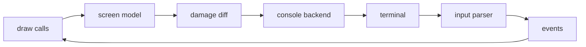
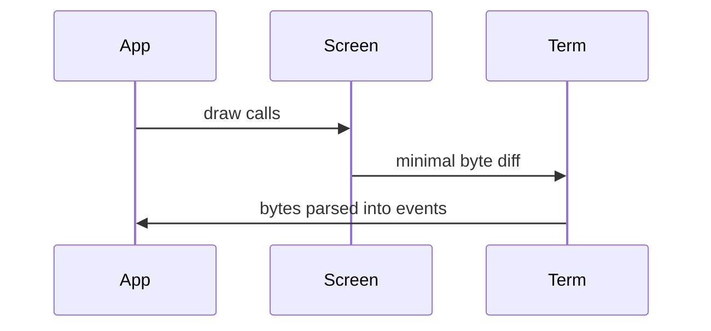

# Architecture

The understand path through _Tcell_: how a program's drawing calls become the fewest bytes a terminal can accept, and how the bytes a terminal sends back become events.

Planned: the screen model and its damage tracking, the terminal backends that all sit behind one interface, the input and output pipelines, how keyboard protocols are negotiated, Unicode and width handling, the concurrency rules a program has to keep, and a table that maps each topic to the source file that owns it.

This page is a stub: it is published so that the navigation of this wiki is complete before its pages are written. Until this page is written, the library's [change notes for v3](https://github.com/gdamore/tcell/blob/main/CHANGESv3.md) name the same subsystems and are written from the code.

## Renderer Probe

Temporary scaffolding, published on purpose and removed as soon as it is measured. This draft has to
decide whether its diagrams are drawn from a diagram language or written as ASCII art, and the only
measurement that counts is what GitHub's wiki renderer does to the page you are reading. The two blocks
below are the same pipeline in the diagram language; the last one is the same pipeline as text. If the
first two arrive as pictures, diagrams here use the diagram language.





The same data flow in the fallback format, which is also what a reader in a terminal sees:

```text
draw calls -> screen model -> damage diff -> console backend -> terminal
     ^                                                                   |
     +----------- events <- input parser <- bytes read from terminal -----+
```
